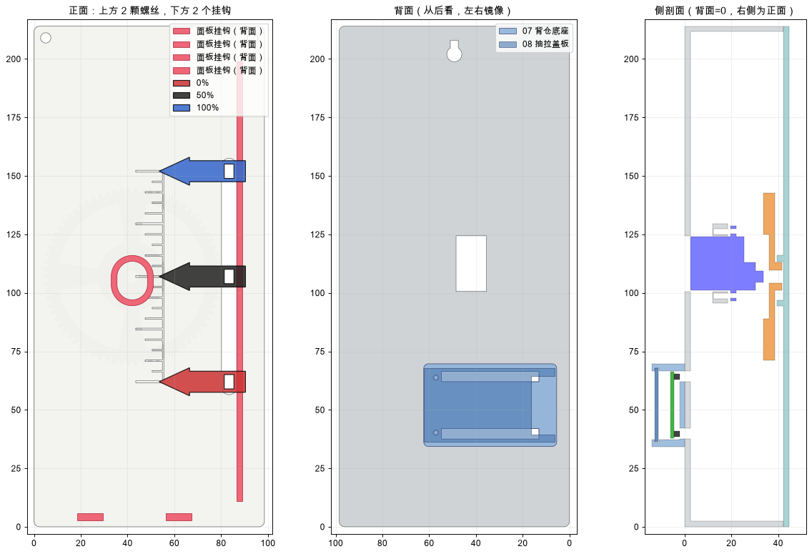

# Codex Quota Gauge

A 3D-printed desk gauge that shows how much of your **Codex** usage quota is left. An SG90 servo turns a 74-tooth gear, the gear drives a rack, and a red arrow moves along a 90 mm tick scale. An ESP32 drives the servo, and a small macOS menu bar app reads your quota and sends it to the ESP32 over Bluetooth LE.

[简体中文说明](README.zh-CN.md)

## Downloads

- [Download the macOS app (DMG)](https://github.com/yingzhexu/esp32-codex-quota-gauge/raw/refs/heads/main/release/CodexGauge.dmg)
- [Print-ready STL parts](hardware/STL/) · [STEP models and CAD source](hardware/CAD/)
- [ESP32 firmware](firmware/QuotaGaugeBLE/) · [macOS app source](macos-app/) · [Python tools](tools/python/)
- [Communication protocol and modification guide (Chinese)](docs/protocol-and-hacking.zh-CN.md)



> Not affiliated with OpenAI. The app reads the quota from the Codex CLI that is already installed and signed in on your Mac (`codex app-server`, read-only). No credentials are stored and no model calls are made.

## Features

- 90 mm pointer stroke, tick-only solid faceplate, large arrow
- ESP32 sits in a pod on the back, USB-C exposed on the side
- Only **8 M2 screws**: faceplate hooks, slide-in pod lid, press-fit arrow
- Every part prints **without supports**
- macOS menu bar app: live 5-hour and weekly quota, auto sync, test slider, numeric calibration, servo speed, launch at login, English and Chinese

## Repository layout

| Path | Contents |
|---|---|
| `hardware/STL/` | Print-ready parts, already oriented for printing |
| `hardware/CAD/` | STEP files, the parametric CadQuery source (`build_v5.py`), `parameters.json` and check scripts |
| `hardware/images/` | Design overview and servo mounting images |
| `hardware/verification/` | Interference, rotation sweep, assembly path and gear mesh results |
| `firmware/QuotaGaugeBLE/` | ESP32 BLE firmware (Arduino) |
| `firmware/ServoTest/` | USB-serial servo test sketch |
| `macos-app/` | Menu bar app source (`Sources/main.swift`) and `build.sh` |
| `release/CodexGauge.dmg` | Prebuilt app (universal, macOS 13+) |
| `tools/python/` | Optional command-line bridge (`codex_gauge_ble.py`) |
| `docs/` | Communication protocol and guide to using the gauge with other data sources |
| `docs/protocol-and-hacking.zh-CN.md` | BLE protocol and how to repurpose the gauge (Chinese) |

## Bill of materials

| Item | Qty |
|---|---:|
| SG90 servo (180°) with its cross horn and screws | 1 |
| ESP32 DevKit, 30-pin, USB-C (51.85 × 28.35 mm, Ø3 holes 46.5 × 23.5 mm) | 1 |
| Female-female Dupont jumpers | 3 |
| M2×6 screws | 4 |
| M2×8 screws (or the long screws supplied with the SG90) | 2 |
| M2×12 screws (M2×10 also works) | 2 |
| PLA filament; printer bed ≥ 215 mm | |

## Printing

PLA at 0.2 mm layers; 4 walls for the gear and rack, 3 for everything else. Import at 100 % scale. The files are already oriented for printing.

**Turn supports off for every part.** Overhangs are short bridges (≤ 11 mm) or 45° slopes. Supports would grow into the tick grooves, the horn pocket, the rack teeth and the lid grooves, and you would not be able to assemble the parts.

| File | Qty | Notes |
|---|---:|---|
| `01_plaque_back` | 1 | 98.5 × 214 mm, back face down |
| `02_front` | 1 | Face down (ticks on the bed) |
| `03_pinion_74T` | 1 | Horn pocket down; enable elephant-foot compensation |
| `04_horn_keeper`, `05_rack_slider`, `06_arrow`, `07_pod_base`, `08_pod_lid` | 1 each | |
| `S_servo_ear_shim_1.0mm_print2` | 2 | Use the 0.5 / 1.5 / 2.0 mm shims only if needed |
| `T5_horn_fit` | 1 | Print first: about 10 min, checks the SG90 cross horn fit |
| `T1`–`T4`, `optional_horn_spacer_*` | optional | Fit test pieces |

## Wiring

| SG90 wire | ESP32 pin |
|---|---|
| Brown (GND) | **GND** |
| Orange (signal) | **D13** |
| Red (+) | **3V3** (on many USB-C FT232 boards, VIN does not carry 5 V from USB) |

Do not plug the servo's 3-pin connector straight onto the header. The pin order does not match the board, and the servo would get reversed power. Use three separate jumpers. If the board resets when the servo moves, add a 470–1000 µF capacitor across red and brown.

## Assembly

1. Put two 1.0 mm shims on the ear posts. Drop the servo in from the front and route its lead through the tunnel under a post. Fix it with 2 × M2×8.
2. Plug the 3 jumpers onto **3V3, GND and D13** (all at the USB end). Place the pod base on the back of the case. Seat the ESP32 component side out, pins in, so its USB-end holes go over the locating pins and the pins and jumpers pass through the two slots. Drive 2 × M2×12 through the board and pod into the case.
3. Slide the pod lid in from the antenna end until it clicks.
4. Inside the case, connect the jumpers to the servo lead.
5. In the app, press **Center 1500**.
6. Put the rack in the rail. Seat the cross horn in the gear pocket, fit the keeper with 2 × M2×6, then push the gear onto the servo spline and fit the horn's centre screw.
7. Faceplate: place it about 3.5 mm high, lower it over the arrow neck and gear hub, slide it down 3.5 mm so the bottom hooks engage, then fit 2 × M2×6 at the top.
8. Press the arrow onto the neck. If it is loose, add a drop of glue.
9. Calibrate 0 % and 100 % in the app.

## Firmware

Open `firmware/QuotaGaugeBLE/QuotaGaugeBLE.ino` in the Arduino IDE with the ESP32 core 3.x installed. Select **ESP32 Dev Module** with **Flash Mode DIO, Flash Size 4MB, Upload Speed 115200**. With the default QIO / 921600 settings, some FT232 boards fail to read the flash.

```bash
arduino-cli compile --upload --fqbn "esp32:esp32:esp32:FlashMode=dio,FlashSize=4M,UploadSpeed=115200" -p /dev/cu.usbserial-XXXX firmware/QuotaGaugeBLE
```

The board advertises as **CodexGauge**. It accepts text commands over BLE (Nordic-style RX/TX characteristics) or USB serial at 115200 baud:

| Command | Action |
|---|---|
| `STATUS` | Report calibration, pulse and speed |
| `P <µs>` | Move to a raw pulse width (500–2500) |
| `CAL <µs0> <µs100>` | Save the 0 % / 100 % pulses |
| `Q <percent>` | Show quota (needs CAL) |
| `T <percent>` | Test position (needs CAL; not counted as quota data) |
| `SPEED <°/s>` | Servo speed 10–400, saved |
| `STALE` / `OFF` | Mark data stale / release the servo |

The servo is released shortly after it reaches each target, so it does not buzz. Calibration and speed are kept in flash across power cycles.

## macOS app

Open `release/CodexGauge.dmg` and drag **Codex Gauge** to Applications. The app is ad-hoc signed and not notarized, so the first time you open it, right-click the app and choose **Open**. Allow Bluetooth when macOS asks.

The app needs the Codex CLI, which comes with the ChatGPT desktop app, or a `codex` binary in `/opt/homebrew/bin`, `/usr/local/bin` or `~/.local/bin`, already signed in.

- The menu bar shows the remaining percentage. The gauge icon can be turned on in Settings.
- Click the percentage to see the 5-hour and weekly windows with their reset times, and to toggle auto sync.
- **Settings & Calibration** has four tabs:
  - **Test**: percentage slider and full sweep.
  - **Calibration**: type the pulse values, or jog the servo and capture each end.
  - **Settings**: quota shown, servo speed, refresh interval, language, menu bar icon, launch at login.
  - **Log**: commands and replies.

To build the app yourself (only the Command Line Tools are needed, not Xcode):

```bash
cd macos-app && ./build.sh
```

## Regenerating the models

```bash
cd hardware/CAD
pip install -r requirements.txt
python build_v5.py          # STEP + STL + gear mesh check
python check_v5.py          # static interference at 0/25/50/75/100 %
python sweep_v5.py          # rotation sweep of gear, horn and screws
python assembly_path_v5.py  # straight-line insertion of every part
```

Servo, horn, board and gear dimensions live in `parameters.json`.

## Status

The V5 design passes all model checks (no tooth overlap, zero interference, rotation sweep and assembly path clear). The previous version (V4, 60 mm stroke) was built and calibrated successfully. V5 itself has not yet been fully printed and assembled. Please report fit issues.
